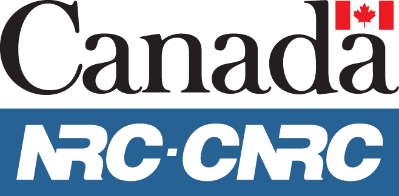

<!-- To add a background photo later, add: style="background-image: url('/assets/images/ottawa.jpg')" -->
<section class="hero">
  

    
17th International Conference on Quantum Communication, Measurement and Computing

    <h1 class="hero-title">QCMC 2027</h1>
    
August 9–13, 2027 · University of Ottawa, Ottawa, Canada

  

</section>

## About QCMC 2027

QCMC 2027 is the 17th International Conference on Quantum Communication, Measurement and Computing (QCMC). The conference will be held **August 9–13, 2027** at the Learning Crossroads (CRX), University of Ottawa, Ottawa, Canada. We anticipate approximately 300 participants, with a program featuring invited and contributed talks, poster sessions, sponsor exhibits, a banquet, and a conference excursion.

The QCMC series was established in Paris in 1990 and has since held 16 conferences worldwide, most recently in Chennai, India (2024). QCMC 2027 is locally organized by the **University of Ottawa** and the **National Research Council Canada (NRC)**. The conference will also feature the [International Quantum Award](https://www.qcmc-conference.org/quantum-award.html), recognizing outstanding achievements in quantum science.

---

## Important Dates

| Event | Date |
|:--- |:--- |
| Conference | August 9–13, 2027 |

*Registration deadlines, abstract submission dates, and further details will be announced soon.*

---

## Scope

The conference covers the following subject areas:

- Quantum Communication and Cryptography
- Quantum Sensing and Metrology
- Quantum Computing and Simulation
- Quantum Networks
- Quantum Information Theory
- Quantum Control and Engineering
- Foundations of Quantum Physics

---

## Organized by

  
  

---
