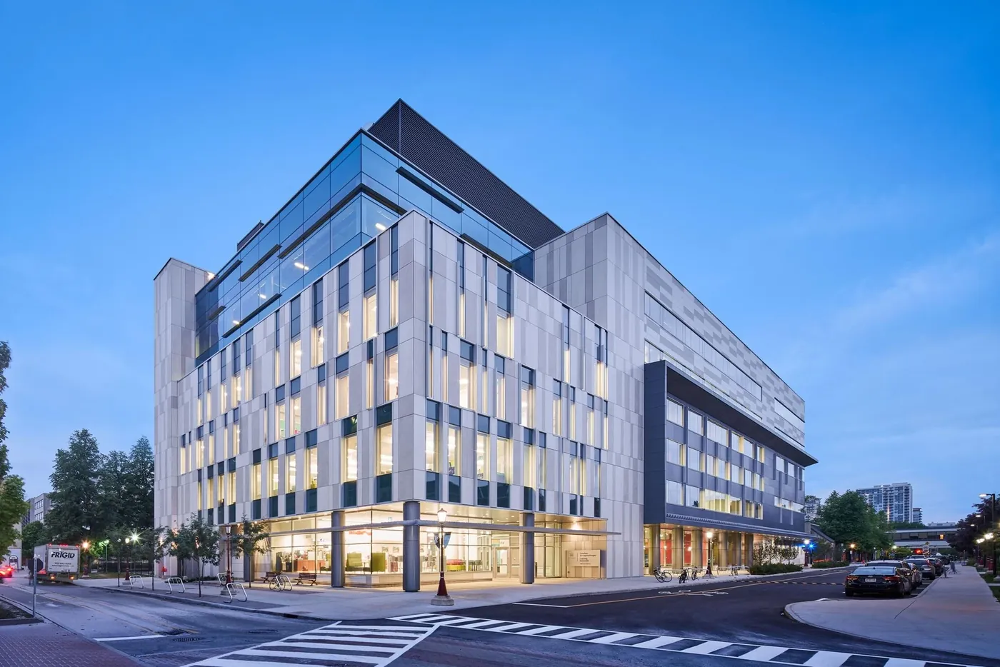
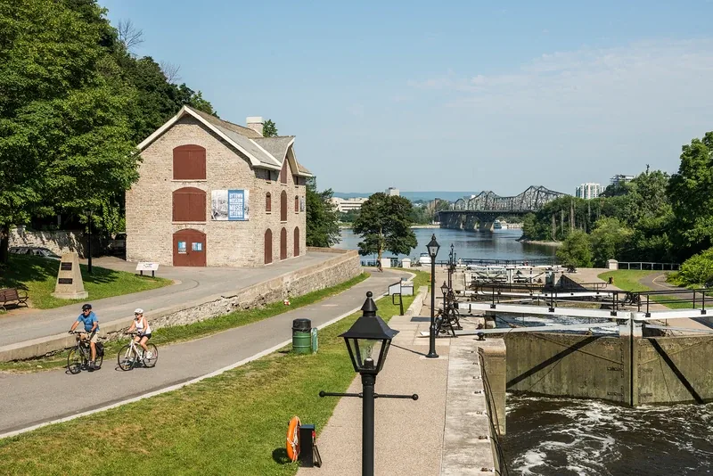
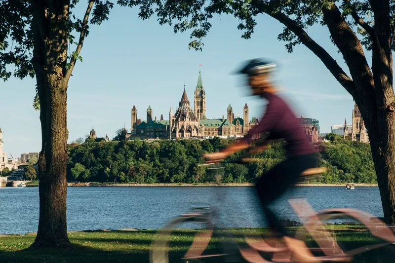

<figure class="photo photo--wide">
  
  <figcaption class="photo-credit">Photo: University of Ottawa</figcaption>
</figure>

## Learning Crossroads (CRX)

QCMC 2027 will be held at the **Learning Crossroads (CRX)** on the University of Ottawa's downtown campus.

**Address:** 100 Louis-Pasteur Private, Ottawa, ON K1N 9N3, Canada 
[CRX building information (uOttawa)](https://www.uottawa.ca/about-us/administration-services/facilities/campus-maps/building/learning-crossroads-crx)

  <iframe title="Map showing the Learning Crossroads (CRX), University of Ottawa" src="https://www.openstreetmap.org/export/embed.html?bbox=-75.6874%2C45.4189%2C-75.6754%2C45.4249&amp;layer=mapnik&amp;marker=45.42194%2C-75.68136" loading="lazy"></iframe>
  <small><a href="https://www.openstreetmap.org/?mlat=45.42194&amp;mlon=-75.68136#map=17/45.42194/-75.68136">View larger map</a></small>

---

## Ottawa

  <figure class="photo">
    
    <figcaption class="photo-credit"><a href="https://ottawatourism.ca/">Photo: Ottawa Tourism</a></figcaption>
  </figure>
  

The University of Ottawa campus is situated in downtown Ottawa on the banks of the Rideau Canal, a UNESCO World Heritage Site that is lined with walking and cycling paths. Parliament Hill, approximately a 15-minute walk from campus, is the seat of government with towers, courtyards, lawns, monuments, dramatically situated on a cliff over the Ottawa River with views toward Quebec. A 10-minute walk from campus is the ByWard Market, one of Canada's oldest public markets and one of Ottawa's principal cultural districts, featuring restaurants, cafés, galleries, local food vendors, boutiques, and outdoor patios.

  

  <figure class="photo">
    
    <figcaption class="photo-credit"><a href="https://ottawatourism.ca/">Photo: Ottawa Tourism</a></figcaption>
  </figure>
  

Ottawa is located on the Ottawa River at the boundary between the provinces of Ontario and Quebec, where Canada's English- and French-speaking cultures meet. The river has served as an important transportation route and gathering place for Indigenous peoples for thousands of years and today forms the boundary between Canada's two largest provinces. As the country's largest officially bilingual city, Ottawa offers visitors a distinctive blend of linguistic and cultural traditions reflected throughout the city.

  

